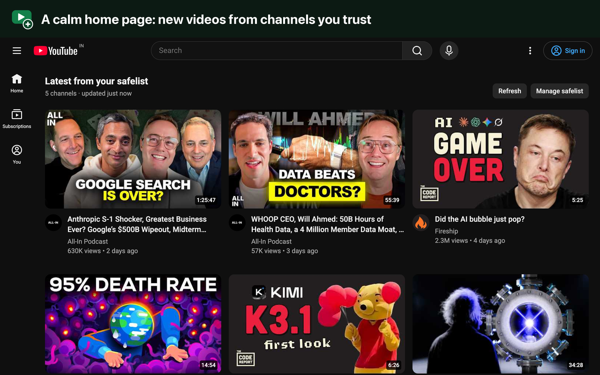
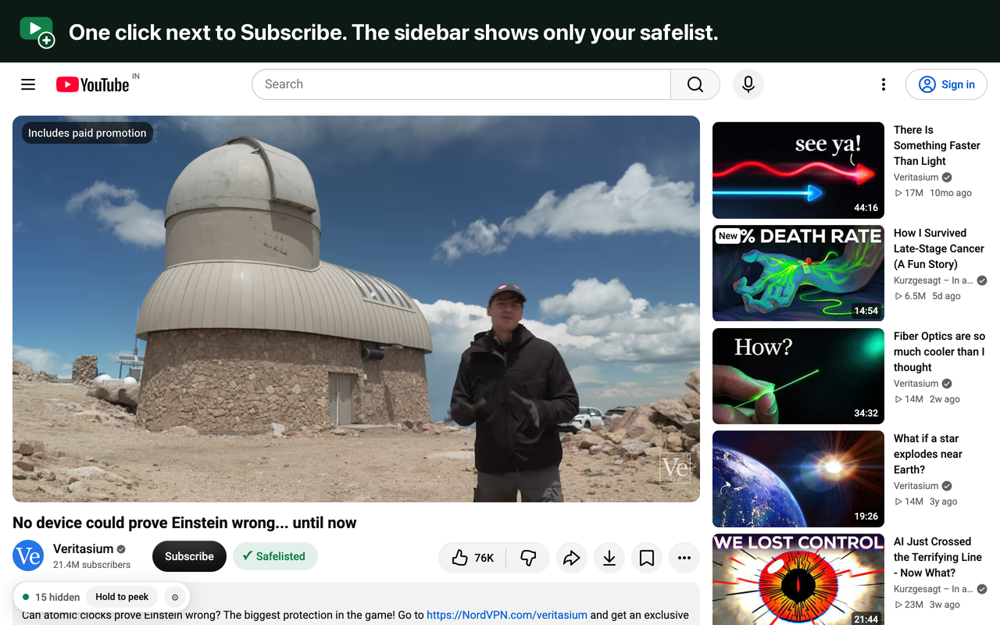
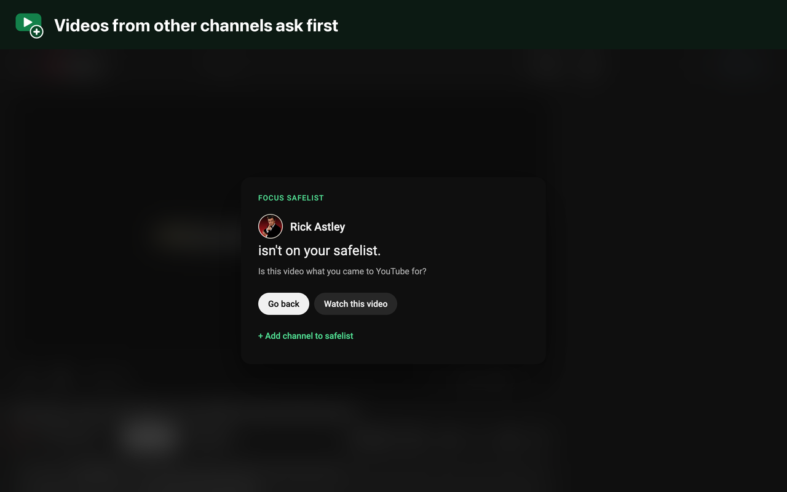
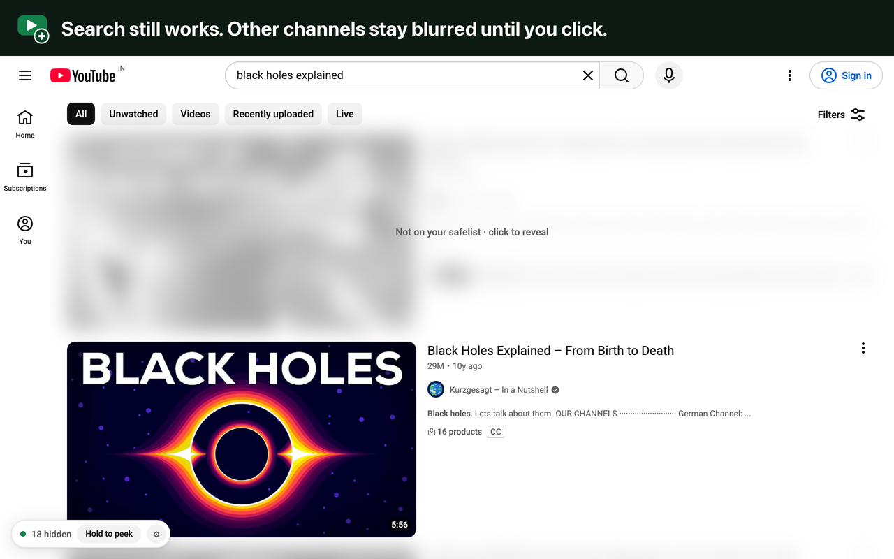
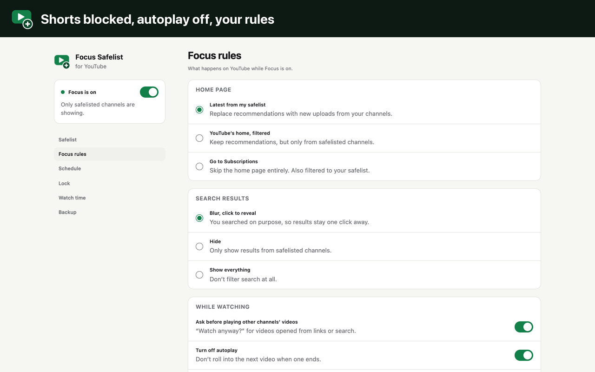

<p align="center">
  
</p>

<h1 align="center">Focus Safelist for YouTube</h1>

<p align="center">
  YouTube, only from channels you trust.<br>
  A free, open-source Chrome extension that hides recommendations and Shorts from every channel you haven't chosen.
</p>

<p align="center">
  <a href="LICENSE">MIT License</a> · <a href="PRIVACY.md">Privacy</a> · <a href="https://github.com/thisisjoey/focus-safelist/issues">Report an issue</a>
</p>



## Why

YouTube's home page and sidebar are tuned to keep you watching. You open it for one video and lose an hour. Focus Safelist doesn't block YouTube. It narrows it down to the channels you trust, your *safelist*, and hides the rest.

## Features

- **Calm home page.** Recommendations are replaced by the latest uploads from your safelisted channels, in YouTube's familiar layout.
- **One-click safelisting.** A **+ Safelist** button sits next to Subscribe on every video and channel page.
- **Filtered sidebar.** Next to the video you're watching, only safelisted channels are suggested.
- **"Watch anyway?"** Videos from other channels (from a link, say) ask before they play.
- **Shorts blocked everywhere.** Shelves, tabs, links, filter chips, and `/shorts` pages.
- **Search that still works.** Results from other channels are blurred until you click one.
- **No autoplay rabbit hole.** Autoplay is switched off and end-screen suggestions are hidden.
- **Hold to peek.** See what's hidden when you really need to.
- **Schedule.** Filter only during the hours you choose (Shorts can stay blocked all the time).
- **Optional lock.** Add a countdown or a typed sentence before Focus can be turned off.
- **Watch time.** Time spent on your safelist vs. everything else, per day.
- **Optional extras.** Hide comments, Explore/Trending and the notifications bell.
- **Light and dark mode**, plus Chrome Sync for your safelist and settings.

| | |
|---|---|
|  |  |
|  |  |

## Install

**Chrome Web Store:** coming soon.

**From source:**

1. Download this repository (**Code → Download ZIP**) and unzip it, or `git clone https://github.com/thisisjoey/focus-safelist.git`.
2. Open `chrome://extensions` and turn on **Developer mode**.
3. Click **Load unpacked** and select the project folder.
4. Reload any YouTube tabs that were already open.

## Privacy

There are no accounts, analytics, tracking or servers. Your safelist and settings live in `chrome.storage` and are synced only by Chrome itself. The extension talks only to youtube.com. See [PRIVACY.md](PRIVACY.md) for details.

## How it works

Every video tile in a filtered area starts hidden through CSS. It is shown only once its channel is confirmed to be on your safelist, so nothing flashes on screen while the page loads.

Channels are matched in this order:

1. **Channel ID**, read from YouTube's own page data by a small script that runs in the page (`content/page-world.js`).
2. **@handle**, from links in the tile.
3. **Display name**, but only when IDs and handles can't settle it.

The calm home page reads the public Videos tab of each safelisted channel and caches the results for 20 minutes.

## Project structure

```
manifest.json            Manifest V3
background.js            settings migrations, opens the settings page
lib/
  core.js                pure logic: matching, parsing, schedule (unit-tested)
  store.js               chrome.storage wrapper, channel lookup, import/export
  unlock.js              optional lock (countdown / typed sentence)
  ui.css                 shared styles for the popup and settings page
content/
  selectors.js           every YouTube DOM selector, in one place
  page-world.js          reads channel IDs from YouTube's page data
  state.js               settings and on/off state → <html data-yf-*> attributes
  filter.js              hide / blur / peek
  watch.js               Safelist button, "Watch anyway?", autoplay, watch time
  home-feed.js           "Latest from your safelist" home page
  main.js                wiring, Shorts and home redirects
  focus.css              styles for what the extension adds to YouTube
popup/  options/         toolbar popup and settings page
store/                   Chrome Web Store screenshots and listing text
scripts/                 make_icons.py, package.sh
tests/                   unit tests for lib/core.js
```

## Development

No build step: edit the files, then click the reload icon on the extension's card in `chrome://extensions`.

```sh
node --test tests/*.test.js       # unit tests
python3 scripts/make_icons.py     # regenerate icons (needs Pillow)
sh scripts/package.sh             # build dist/focus-safelist-<version>.zip for the Chrome Web Store
```

### When YouTube changes its layout

YouTube changes its markup often. If something stops being hidden, or the button disappears, the fix almost always belongs in [`content/selectors.js`](content/selectors.js). Two other places depend on YouTube's internals:

- `content/page-world.js` reads YouTube's page data.
- `parseChannelVideos` in `lib/core.js` reads a channel's Videos tab.

## Contributing

Issues and pull requests are welcome. Please run the unit tests before opening a PR, and describe what you tested on YouTube: light and dark mode, signed in or signed out.

## Limits

- Chrome sync storage holds about 400 safelisted channels.
- The home page downloads each channel's Videos tab (around 1 MB per channel, cached for 20 minutes).
- The optional lock adds friction, not security.

## License

[MIT](LICENSE) © 2026 Bhupesh Joshi

Focus Safelist is an independent project and is not affiliated with or endorsed by YouTube or Google.
